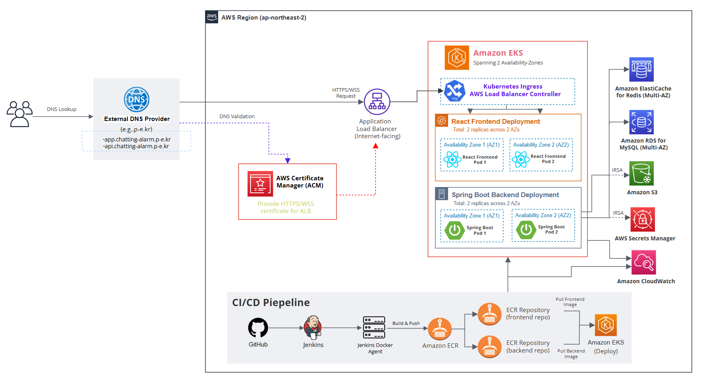
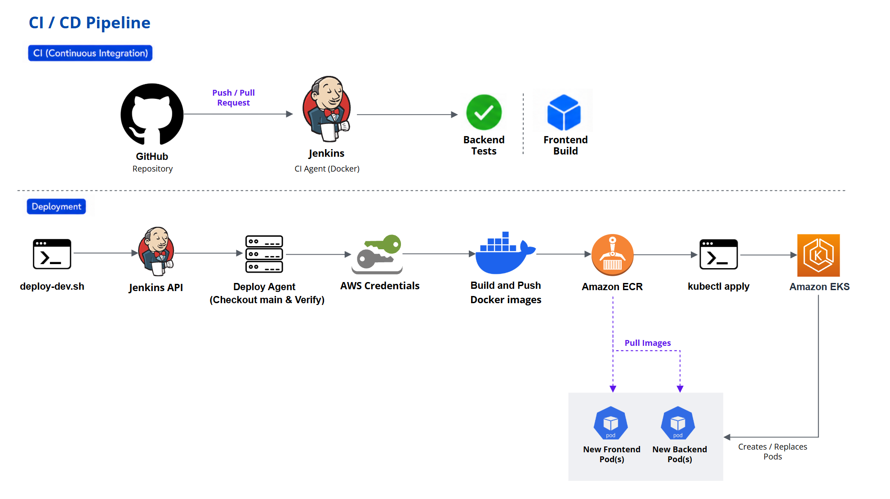
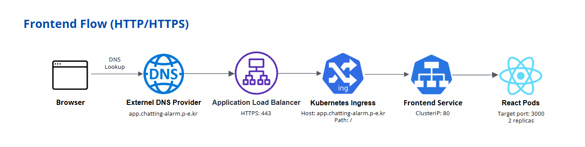
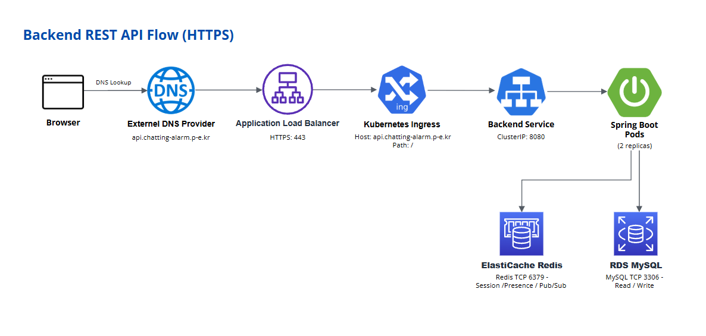
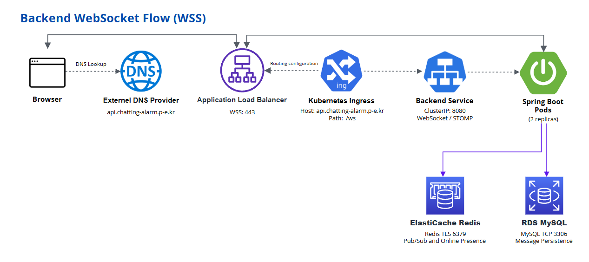

# 모두톡

1인 개발로 진행한 Spring Boot기반 채팅 서비스 프로젝트입니다.

약 2개월간 진행했으며, Kubernetes 기반으로 배포 환경을 구축했습니다.

## 주요 기능

- Google, Naver, Kakao 소셜 로그인 기능
- WebSocket/STOMP를 활용한 실시간 채팅 기능
- 1:1 채팅과 단체 채팅방 생성 기능
- 친구 코드를 이용해 요청을 보내고 상대방이 수락하는 친구 추가 방식
- 단체방에 참여자 초대가 가능하고 참여자 간 친구 요청 가능
- 온라인 상태와 현재 접속중인 이용자 목록 표시
- 읽지 않은 메세지 알림 제공
- 파일 첨부 및 다운로드, 이모지 첨부 기능
- 프로필 이름과 이미지 변경 기능

## 사용 기술

### App

### Infra

## 아키텍처

### 전체 구성

외부 DNS에 프론트엔드, 백엔드, Grafana 도메인을 각각 등록하고, 앱 ALB는 Ingress의 규칙에 따라 프론트엔드와 백엔드 Pod로 요청을 전달합니다. Grafana는 별도 ALB를 통해 지정한 관리자 IP에서만 접근이 가능하도록 구성했습니다.

프론트엔드와 백엔드는 각각 2개의 Pod로 배포했고, 가용영역 간 분산 배치를 위해 Topology Spread Constraints를 적용했습니다. 노드 유지보수 시에는 동시에 두 Pod가 중단되지 않도록 PodDisruptionBudget을 설정했습니다.

Prometheus로 백엔드와 Kubernetes 메트릭을 수집하고 Grafana에서 이를 시각화합니다. 모니터링 데이터는 EBS에 저장하고 CloudWatch는 로그 수집과 AWS 리소스 경보에 사용합니다.

### CI/CD

**CI** - `main` 브랜치에 새 코드가 push되거나 Pull Request가 생성되면 Jenkins에서 백엔드 테스트와 프론트엔드 빌드를 실행합니다.

**CD** - 배포는 Jenkins에서 수동으로 실행합니다. AWS 인증 후 새로운 코드를 Docker 이미지로 빌드해서 ECR에 업로드하고 `kubectl set image`로 EKS Deployment의 컨테이너 이미지 주소를 변경합니다.
마지막으로 Kubernetes는 이 변경 사항을 감지하여 RollingUpdate 방식으로 새 Pod을 배포합니다.

### 프론트엔드 요청 흐름

사용자가 app.chatting-alarm.p-e.kr에 접속하면 외부 DNS를 통해 ALB의 IP 주소를 조회하고 ALB로 HTTPS 요청을 보냅니다. ALB는 ACM 인증서를 사용해 TLS 연결을 종료한 뒤, Ingress 설정으로 만든 호스트 라우팅 규칙에 따라 Frontend Target Group을 선택합니다. 이후 등록된 두 개의 React Pod 중 정상 상태인 Pod 중 하나로 요청을 전달합니다.

### 백엔드 REST API 요청 흐름

사용자가 `api.chatting-alarm.p-e.kr`로 REST API를 요청하면 외부 DNS를 통해 ALB의 IP 주소를 조회하고 ALB로 HTTPS 요청을 보냅니다. ALB는 ACM 인증서를 사용해 TLS 연결을 종료한 뒤, Ingress 설정으로 만든 호스트 라우팅 규칙에 따라 Backend Target Group을 선택합니다. 이후 등록된 두 개의 Spring Boot Pod 중 정상 상태인 Pod 하나로 요청을 전달합니다. 애플리케이션은 Redis를 이용해 실시간 이벤트를 전달하고 사용자·친구·채팅방·메세지 등의 데이터는 RDS MySQL에 저장합니다.

### 백엔드 WebSocket 요청 흐름

브라우저가 api.chatting-alarm.p-e.kr/ws로 WSS 연결을 요청하면 외부 DNS를 통해 ALB의 IP 주소를 조회하고 ALB에 연결합니다. ALB는 ACM 인증서를 사용해 TLS 연결을 종료한 뒤, Ingress 설정으로 만든 호스트 및 경로 라우팅 규칙에 따라 Backend Target Group을 선택합니다. 이후 등록된 Spring Boot Pod 중 정상 상태인 Pod 하나로 연결을 전달합니다. 각 Pod는 Redis Pub/Sub을 이용해 채팅 메세지를 공유하고 접속 상태는 Redis에서 관리하며 채팅 메세지는 RDS MySQL에 저장합니다.

## 배포 방법

Terraform으로 AWS 인프라를 구성하고, Docker 이미지를 ECR에 올린 뒤 EKS에 배포합니다. 최초 배포는 `infra/kubernetes/apply.sh`로 진행하며, 이후 코드 변경은 Jenkins 배포 작업에서 수동으로 반영합니다.

환경 설정과 배포 명령은 [AWS 배포 가이드](docs/deployment.md)에 정리했습니다. 현재는 운영 비용을 줄이기 위해 배포를 중단한 상태입니다.

## 모니터링

Prometheus로 백엔드 메트릭을 수집하고 Grafana에서 서버 자원과 API 상태를 확인합니다. 설치와 접속 방법은 [모니터링 가이드](docs/monitoring.md)를 참고하세요.

## Trouble Shooting

### AWS Load Balancer Controller 시작 실패

| &nbsp;구&#8288;분&nbsp; | 내용 |
|---|---|
| &nbsp;문&#8288;제&nbsp; | ALB Controller 실행 시 `failed to get VPC ID ec2imds: GetMetadata context deadline exceeded` 오류가 발생했습니다. |
| &nbsp;원&#8288;인&nbsp; | EC2 Instance Metadata(IMDS) 요청이 시간 초과되어 Controller가 실행에 필요한 VPC ID를 가져오지 못했습니다. |
| &nbsp;해&#8288;결&nbsp; | `apply.sh`에서 Terraform의 `vpc_id` output을 읽고, `--aws-vpc-id=${VPC_ID}` 옵션으로 Controller에 직접 전달했습니다. |

### EKS에서 S3 업로드 실패

| &nbsp;구&#8288;분&nbsp; | 내용 |
|---|---|
| &nbsp;문&#8288;제&nbsp; | EKS의 Backend Pod에서 AWS 임시 자격 증명을 가져오지 못해 S3 파일 업로드에 실패했습니다. |
| &nbsp;원&#8288;인&nbsp; | S3 SDK는 있었지만 STS SDK 의존성이 없어, IRSA의 Web Identity Token을 임시 자격 증명으로 교환하지 못했습니다. |
| &nbsp;해&#8288;결&nbsp; | `pom.xml`에 AWS STS SDK 의존성을 추가한 뒤, IRSA를 통한 S3 파일 업로드가 정상적으로 동작하는 것을 확인했습니다. |

### RollingUpdate 중 Pod Pending 발생

| &nbsp;구&#8288;분&nbsp; | 내용 |
|---|---|
| &nbsp;문&#8288;제&nbsp; | 두 개의 `t3.small` 노드에서 배포를 진행할 때 새 Pod가 `Pending` 상태에 머물렀습니다. |
| &nbsp;원&#8288;인&nbsp; | 기존 Pod와 새 Pod를 동시에 실행할 노드 자원이 부족했습니다. |
| &nbsp;해&#8288;결&nbsp; | 노드를 `t3.medium`으로 변경하고, 프론트엔드의 RollingUpdate 전략을 `maxUnavailable: 1`, `maxSurge: 0`으로 설정했습니다. 기존 Pod 하나를 먼저 종료해 자원을 확보한 뒤 새 Pod를 배포하도록 했습니다. |

### EBS CSI 드라이버 누락으로 모니터링 설치 중단

| &nbsp;구&#8288;분&nbsp; | 내용 |
|---|---|
| &nbsp;문&#8288;제&nbsp; | Prometheus·Grafana 설치 중 `ebs.csi.aws.com not found` 오류로 설치 스크립트가 중단됐습니다. |
| &nbsp;원&#8288;인&nbsp; | 모니터링 데이터를 EBS에 저장하도록 설정했지만, 볼륨 생성과 연결을 담당하는 EBS CSI 드라이버가 클러스터에 없었습니다. |
| &nbsp;해&#8288;결&nbsp; | Terraform에 EBS CSI 추가 기능과 전용 IAM Role을 추가하고 IRSA로 권한을 연결했습니다. 드라이버가 정상 실행되는 것을 확인한 뒤 모니터링 설치를 다시 진행했습니다. |

## 배운 점
- **Kubernetes 배포:** ALB와 Ingress를 활용한 요청 라우팅과 Pod 분산 배치 방법을 이해했습니다.
- **Redis Pub/Sub:** 서로 다른 Pod에 연결된 사용자 간 채팅 메세지를 공유하는 방법을 배웠습니다.
- **CI/CD 구성:** Jenkins로 테스트와 빌드 과정을 자동화하고, AWS 배포 파이프라인을 구성하는 경험을 했습니다.

## 아쉬운 점

- **성능 검증 부족:** 여러 사용자가 동시에 채팅하는 상황을 테스트하지 못했습니다. 이후에 부하 테스트를 진행하여 서버 자원 사용량이나 메세지 지연 시간 등을 확인하고 싶습니다.

- **운영 경험 부족:** 실제 운영 환경에서 장기간 서비스를 운영해보지 못한 점이 아쉽습니다. 운영 중 발생할 수 있는 장애 상황 등에 대한 경험을 하며 서비스의 안정성을 높이고 싶습니다.

## 개발자

- GitHub: [lty02-ops](https://github.com/lty02-ops)
